# Step 25 report: cube modes none / linear / bilinear on run 20261117T152130Z_run_Vs0yvl

**RUN** = `output/orbits_melbourne/20261117T152130Z_run_Vs0yvl`: the `hex7_async_10deg` acquisition validated in
report 23 (`Prompts/report_23.md`).
- 7 satellites: 0, 2, 5 nadir; 1, 4 fore; 3, 6 aft, at about 10 deg along track.
- EEVEE renders with walls, 1000 frames per satellite.
- Raw rows from `render_to_raw.py`: 32 bands × 8 TDI rows; band start rows 1020 … 1932, every 28 or 32 rows.

This report compares the three stacking modes of `build_cubes.py`, shows every band of every satellite, and
measures the band-to-band registration the modes are meant to fix.

**Verdict:** use mode **linear** for the nadir views and mode **bilinear** for the fore/aft views. Mode **none**
is not usable with these 32 bands spread over 912 detector rows. It leaves 3.8–3.9 px along track on the nadir
views and 8.8–11 px on fore/aft, instead of the ≈ 0.5 px expected when the step was planned. Every measured
displacement matches the geometry stored in the cubes' frame indices.

Nothing in RUN was modified apart from the three new folders listed in section 8. The raw data (`raw/sat_*.npy`)
and the cubes were not touched.

## Contents

1. [Inputs and conventions](#1-inputs-and-conventions)
2. [Cube inventory](#2-cube-inventory)
3. [Visual inspection](#3-visual-inspection)
4. [Mode differences](#4-mode-differences)
5. [Per-band luminance at fixed points ("spectra")](#5-per-band-luminance-at-fixed-points-spectra)
6. [Band-to-band registration](#6-band-to-band-registration)
7. [Verdict](#7-verdict)
8. [Files, scripts, reproduction](#8-files-scripts-reproduction)

---

## 1. Inputs and conventions

**Cube files.** `RUN/cubes/raw_bands_<mode>/cube_satSS.npz` were written by
`build_cubes.py --source raw --layout raw_bands --mode <mode> --workers 20` (commit c169157). Each file holds:

| key | content |
|---|---|
| `cube` | uint8 [G, C, 32, 4], RGBA; alpha = scene coverage |
| `g` | cube line = row of the ground line in the satellite's OWN frame 0 |
| `cols` | PNG columns (the scene columns of the satellite) |
| `band_rows` | detector row of each band (TDI stage 0 of the band) |
| `frame_index` | none: k = r_b − g, int64 [G, B]; linear: k* float32 [G, C, B]; bilinear: (k*, c*) float32 [2, G, C, B] |
| `frame_t_s`, `metadata` | frame times; build information (JSON) |

**What the modes do.** All three take band b, line g, column c from detector row r_b.

| mode | frame | column | interpolation |
|---|---|---|---|
| none | integer k = r_b − g | c | none (nearest frame) |
| linear | k*(g, c, b): the ground line g crosses row r_b | c | linear in time |
| bilinear | k*(g, c, b) | c*(g, c, b): the ground point of frame-0 pixel (g, c) crosses row r_b | bilinear in (frame, column) |

**No wavelengths.** `raw/bands.json` lists rows only. Every band is the same rendered RGB seen by a different
detector row. Consequences:
- band titles carry the band index and detector row instead of a wavelength;
- no pseudo-RGB at 640/550/470 nm can be made; the rendered RGB of the middle band is shown instead;
- the "spectra" of section 5 are luminance per band, so any variation along the bands is misregistration, not
  spectrum.

**Luminance.** Rec.709 of the RGB DN, 0–255.

**Ground speed.** The ground advances s rows per frame: 1.0082–1.0084 for the nadir views, 0.976–0.982 for
fore/aft. These values come from the stored k*; report 23 gives 1.0083 and 0.978–0.981.

## 2. Cube inventory

All 21 cubes (3 modes × 7 satellites) were present. None had to be built. Every file holds the same keys:
`band_rows, cols, cube, frame_index, frame_t_s, g, metadata`.

**Complete lines.** `build_cubes.py` keeps only the lines seen by all 32 bands within the 1000 frames, so G is
the number of complete lines. The cubes are short along track because the band span (912 rows) uses most of the
1000 frames.

| sat | role | none: G × C, MB | linear: G × C, MB | bilinear: G × C, MB | lines g (none / linear / bilinear) |
|---|---|---|---|---|---|
| 0 | nadir | 88 × 1910, 21.6 | 96 × 1910, 47.0 | 96 × 1910, 70.4 | 933–1020 / 925–1020 / 925–1020 |
| 1 | fore | 88 × 1885, 21.3 | 65 × 1885, 31.4 | 64 × 1885, 46.4 | 933–1020 / 956–1020 / 956–1019 |
| 2 | nadir | 88 × 1910, 21.6 | 96 × 1910, 47.0 | 95 × 1910, 69.7 | 933–1020 / 925–1020 / 925–1019 |
| 3 | aft | 88 × 1884, 21.3 | 67 × 1884, 32.3 | 66 × 1884, 47.8 | 933–1020 / 954–1020 / 954–1019 |
| 4 | fore | 88 × 1882, 21.3 | 65 × 1882, 31.3 | 64 × 1882, 46.3 | 933–1020 / 956–1020 / 956–1019 |
| 5 | nadir | 88 × 1911, 21.6 | 96 × 1911, 47.0 | 95 × 1911, 69.7 | 933–1020 / 925–1020 / 925–1019 |
| 6 | aft | 88 × 1887, 21.3 | 68 × 1887, 32.9 | 67 × 1887, 48.6 | 933–1020 / 953–1020 / 953–1019 |

- **Fore/aft have fewer lines in linear/bilinear.** They advance only about 0.98 rows per frame, so crossing the
  912-row band span takes about 930 frames, and fewer lines complete inside the 1000-frame window.
- **Mode none** has no geometry. It always keeps 1000 − 912 = 88 lines.
- **Alpha.** About 81% of the cube samples are opaque (alpha 255), 18.5% are outside the dataset (alpha 0), and
  0.6–0.7% are partial. The dataset is not a rectangle: the first and last ≈ 260 and ≈ 230 scene columns are
  mostly empty (white in the figures).

## 3. Visual inspection

Every band of every satellite, for every mode, is in `RUN/band_samples/` (section 8). The figures below come from
`RUN/cubes/inspection/` (`scripts/inspect_cubes.py`); the full set is listed in section 8.

### 3.1 Overview: false colour of the 7 satellites

**Encoding.** False colour R / G / B = luminance of bands 0 / 16 / 31 (rows 1020 / 1492 / 1932), each channel
stretched 2–98%. Since every band shows the same scene, a perfectly registered cube is **grey**. Coloured
fringes are band-to-band misregistration.

- **Mode none:** strong rainbow fringes on every edge. They are larger on fore/aft (8.8–11 px) than on nadir
  (≈ 3.9 px).

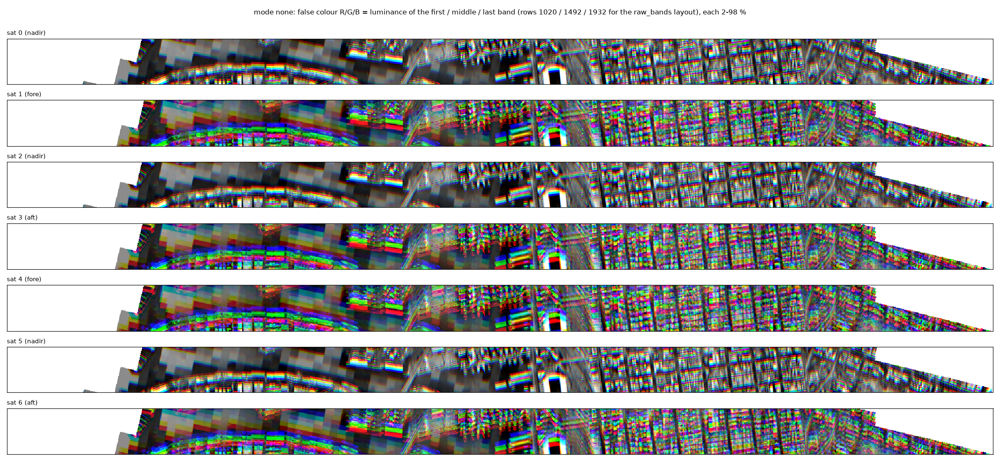

- **Mode linear:** nadir is grey. Fore/aft are grey along track, but faint fringes remain across track at the
  left of the scene (the column drift, section 6.3).

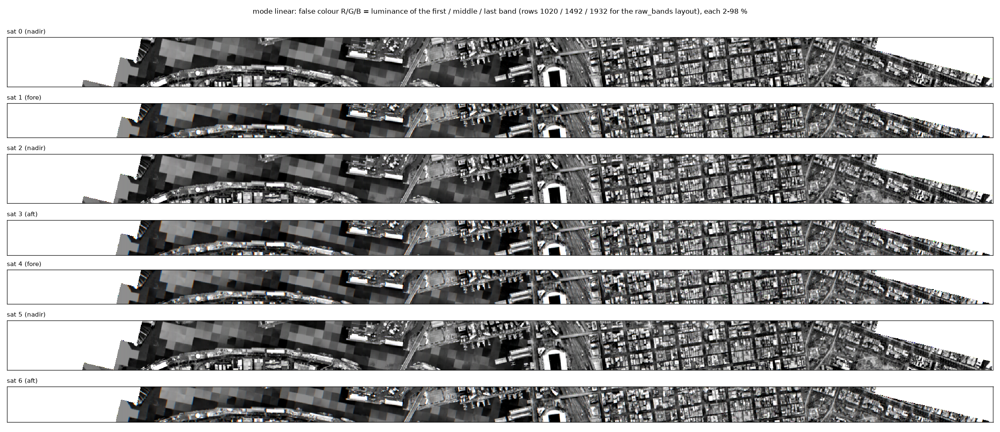

- **Mode bilinear:** grey everywhere.

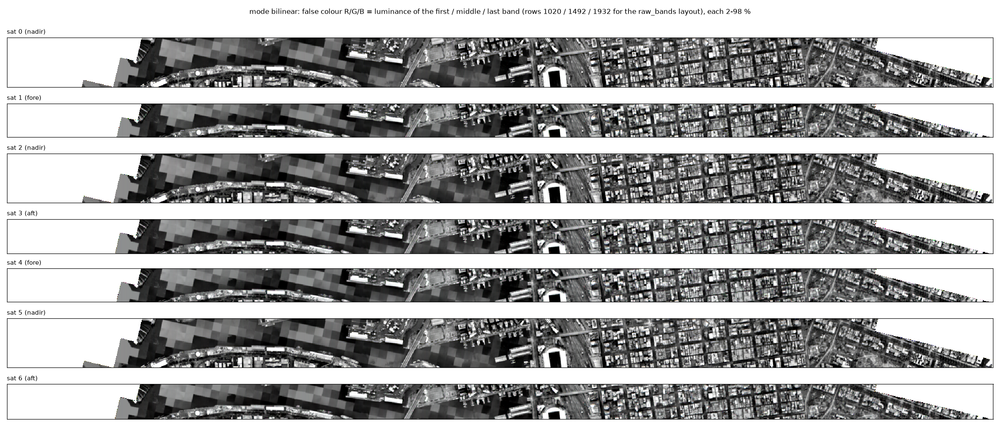

### 3.2 One satellite, three modes (false colour + rendered RGB)

The figures below show:
- satellite 1 (fore): the false colour as above, and the rendered RGB of band 16 (1–99% stretch);
- satellite 0 (nadir): the same composites, for comparison.

| mode | sat 1 (fore) | sat 0 (nadir) |
|---|---|---|
| none | 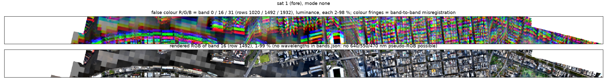 | 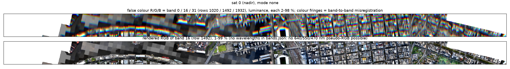 |
| linear | 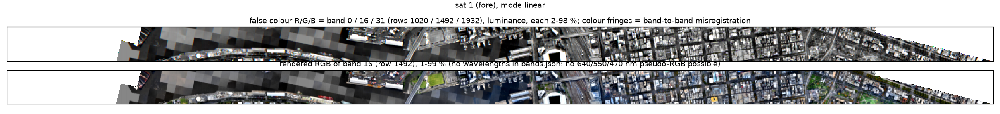 | 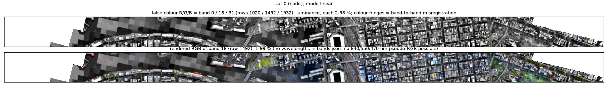 |
| bilinear | 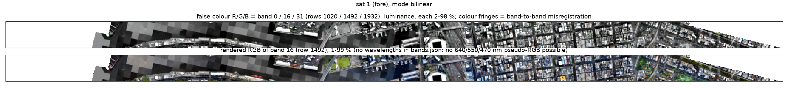 |  |

### 3.3 Band mosaics

These mosaics show the luminance of all 32 bands, one panel each (8 rows × 4 columns). Each figure uses one
2–98% stretch for the whole cube. Panel titles give band index and detector row.

- **Mode none:** the bands visibly slide along track from band 0 to band 31.
- **Mode bilinear:** all bands show the same strip.

Mosaics of every satellite and mode are in `RUN/cubes/inspection/mosaic_satSS_<mode>.png`.

Satellite 1, mode none:

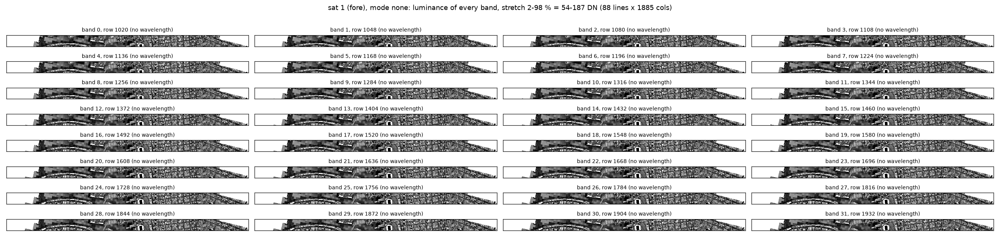

Satellite 1, mode bilinear:

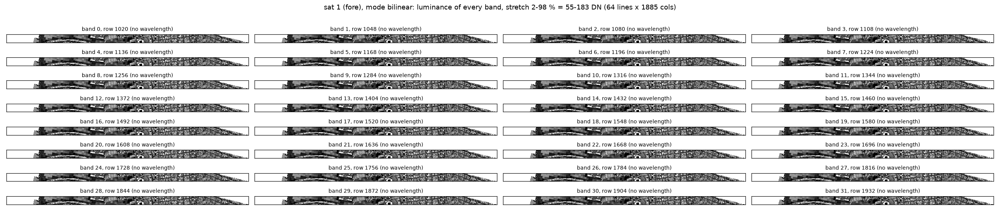

## 4. Mode differences

**Region.** All comparisons in sections 4–6 use, per satellite, the same region for the three modes:
- **lines:** the lines common to the three modes;
- **columns:** the longest contiguous run of columns that are opaque in at least 90% of lines × bands in every
  mode.

A first attempt required 100% opacity. The scene has a few scattered transparent pixels (more in fore/aft views),
so that left only 59–107 columns and noisy results. With 90%, the region keeps 1396–1419 columns, with less than
0.5% non-opaque samples.

**Difference statistics.** Luminance differences on the region, over all 32 bands:

| sat | role | rows/frame s | region lines g | region columns | mean \|linear − none\| DN | mean \|bilinear − linear\| DN | p99 \|lin − none\| / \|bil − lin\| (bands 0, 16, 31) DN |
|---|---|---|---|---|---|---|---|
| 0 | nadir | 1.00829 | 933–1020 (88) | 922–2340 (1419) | 21.46 | 0.06 | 113.8 / 1.0 |
| 1 | fore | 0.97615 | 956–1019 (64) | 938–2335 (1398) | 29.93 | 2.19 | 121.6 / 24.4 |
| 2 | nadir | 1.00815 | 933–1019 (87) | 922–2340 (1419) | 21.28 | 0.05 | 113.1 / 1.0 |
| 3 | aft | 0.98119 | 954–1019 (66) | 936–2336 (1401) | 28.73 | 2.16 | 121.4 / 23.9 |
| 4 | fore | 0.97568 | 956–1019 (64) | 939–2334 (1396) | 30.07 | 2.15 | 120.9 / 23.7 |
| 5 | nadir | 1.00843 | 933–1019 (87) | 922–2340 (1419) | 21.59 | 0.08 | 113.7 / 1.0 |
| 6 | aft | 0.98234 | 953–1019 (67) | 935–2336 (1402) | 28.33 | 2.20 | 122.1 / 24.7 |

- **linear − none** is large everywhere (21–30 DN mean). Mode none samples whole lines of the wrong ground.
- **bilinear − linear** is negligible on the nadir views (0.05–0.08 DN mean, 1 DN at p99). There a ground point
  keeps its column, so c* = c. On fore/aft it is 2.2 DN mean and 24 DN at p99, concentrated on edges.

**Figures.** Each figure shows bands 0, 16 and 31 for none / linear / bilinear, plus the two difference maps.
Each map has its own symmetric scale (p99), on a 400-column crop at the left edge and one at the centre of the
region.

Satellite 1 (fore): the bilinear − linear map shows edge structure, strongest at the left, where the column drift
is largest (section 6.3).

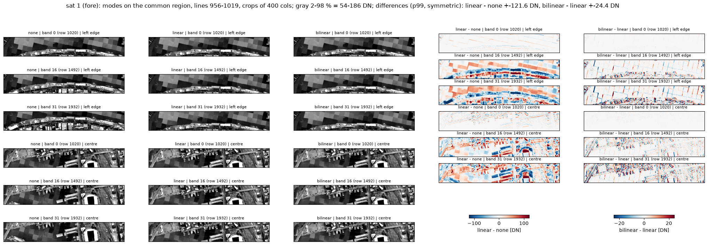

Satellite 3 (aft):

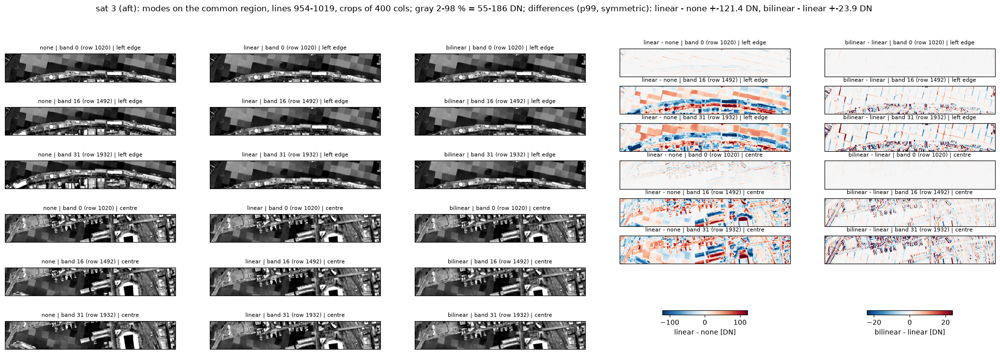

Satellite 0 (nadir): bilinear − linear is ±1 DN noise.

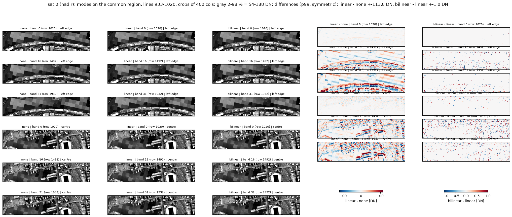

## 5. Per-band luminance at fixed points ("spectra")

**Points.** Four fixed points per satellite, chosen automatically on band 16 of the linear cube, inside
homogeneous, fully opaque 5 × 5 neighbourhoods (the 30% least variable):

| point | rule |
|---|---|
| bright roof | highest luminance |
| road | least saturated pixel within 15% of the median luminance (a grey surface) |
| vegetation | largest excess green 2G − R − B, with G > R and G > B |
| water | darkest 5%, with B > R |

These are colour heuristics, not a land-cover classification. Coordinates are in `data/points.json`.

**Measure.** Each curve is the 3 × 3 mean luminance at the point, per band; one line per mode. Since every band
is the same render, a perfect cube gives a **flat** line.

**Range max − min over the 32 bands, DN:**

| sat | role | point | none | linear | bilinear |
|---|---|---|---|---|---|
| 0 | nadir | region mean | 0.42 | 0.06 | 0.06 |
| 0 | nadir | bright roof | 154.5 | 0.97 | 0.97 |
| 0 | nadir | road | 13.0 | 0.88 | 0.88 |
| 0 | nadir | vegetation | 10.6 | 0.97 | 0.97 |
| 0 | nadir | water | 166.0 | 1.2 | 1.2 |
| 1 | fore | region mean | 0.36 | 0.06 | 0.04 |
| 1 | fore | bright roof | 149.4 | 4.7 | 1.4 |
| 1 | fore | road | 46.3 | 2.8 | 0.89 |
| 1 | fore | vegetation | 49.3 | 0.60 | 0.71 |
| 1 | fore | water | 18.0 | 1.1 | 1.1 |
| 2 | nadir | region mean | 0.46 | 0.06 | 0.05 |
| 2 | nadir | bright roof | 154.8 | 1.2 | 1.2 |
| 2 | nadir | road | 11.3 | 1.0 | 1.0 |
| 2 | nadir | vegetation | 10.5 | 1.0 | 1.1 |
| 2 | nadir | water | 165.6 | 0.94 | 0.94 |
| 3 | aft | region mean | 0.32 | 0.06 | 0.07 |
| 3 | aft | bright roof | 144.6 | 4.6 | 1.2 |
| 3 | aft | road | 36.3 | 4.1 | 1.1 |
| 3 | aft | vegetation | 42.4 | 0.83 | 0.57 |
| 3 | aft | water | 27.3 | 1.0 | 1.2 |
| 4 | fore | region mean | 0.37 | 0.06 | 0.04 |
| 4 | fore | bright roof | 147.8 | 4.4 | 1.4 |
| 4 | fore | road | 11.8 | 1.0 | 0.89 |
| 4 | fore | vegetation | 47.5 | 1.0 | 0.81 |
| 4 | fore | water | 17.9 | 1.1 | 1.0 |
| 5 | nadir | region mean | 0.47 | 0.05 | 0.05 |
| 5 | nadir | bright roof | 153.6 | 0.93 | 0.87 |
| 5 | nadir | road | 1.7 | 0.89 | 0.89 |
| 5 | nadir | vegetation | 11.2 | 1.2 | 1.2 |
| 5 | nadir | water | 166.2 | 1.1 | 1.1 |
| 6 | aft | region mean | 0.31 | 0.05 | 0.07 |
| 6 | aft | bright roof | 142.2 | 4.6 | 1.0 |
| 6 | aft | road | 36.9 | 1.4 | 1.1 |
| 6 | aft | vegetation | 26.7 | 1.1 | 0.80 |
| 6 | aft | water | 22.9 | 1.2 | 0.78 |

- **Mode none:** the "spectrum" of a point changes by tens to 166 DN across the bands. The bands look at
  different ground lines, several pixels apart. The nadir "water" point sits next to a bright edge that slides
  across it.
- **Mode linear:** flat to about 1 DN on nadir. On fore/aft it is flat for homogeneous surfaces, but the bright
  roofs, which have sharp edges, still vary by 4.4–4.7 DN.
- **Mode bilinear:** brings the fore/aft roofs down to 1.0–1.4 DN, the same level as nadir.
- **Region mean:** almost flat in every mode (≤ 0.5 DN). Misregistration moves content but hardly changes the
  average, so a mean spectrum is not a useful test of registration.

Satellite 1 (fore):

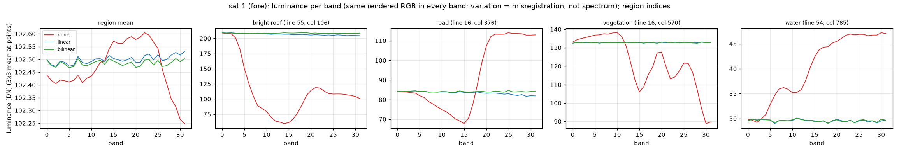

Satellite 3 (aft):

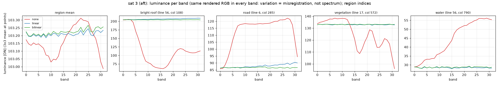

Satellite 0 (nadir):

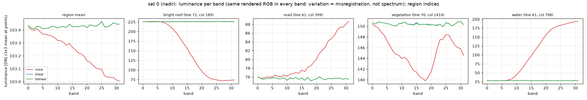

## 6. Band-to-band registration

### 6.1 Method

**Estimator.** For every satellite, mode and band:
- **reference:** band 16 (row 1492), the middle band;
- **input:** gradient magnitude of the luminance × alpha, on the region of section 4 (complete lines only);
- **estimator:** S11 from report 23, `phase_correlation.phase_shift` with a Hann window and a Gaussian low-pass
  (σ = 0.05 cycles/px) on the normalised cross-power spectrum, 1/1000 px upsampling. The gradient reduces the
  effect of contrast differences between images.

**Sign.** The displacement is the scene motion from band 16 to band b (rows +down, columns +right).

**Column blocks.** Besides the whole region ("all"), the region is split into three equal column blocks (left,
centre, right). On oblique views the column drift depends on the column (section 6.3), and a single global
shift averages it out.

**Prediction.** The geometric prediction uses the frame indices stored in the cubes; no geometry is recomputed.

| case | prediction |
|---|---|
| rows, none | band b at line g samples frame r_b − g instead of k\*, so it shows line g + s (k\* − (r_b − g)) (k\* from the linear cube) |
| columns, none and linear | the sample is taken at column c, but the ground point crosses row r_b at column c\* (from the bilinear cube); displacement = mean(c\* − c) of band b − the same for band 16 |
| rows linear, bilinear | zero by construction |

### 6.2 Results

**Max over the 31 bands ≠ 16.** "max abs col L / C / R" is the column maximum in the left, centre and right block.

| sat | role | mode | max abs row | max abs col | RMS | max abs col L / C / R | pred. max abs row / col | max abs (meas − pred) row / col |
|---|---|---|---|---|---|---|---|---|
| 0 | nadir | none | 3.864 | 0.012 | 2.263 | 0.031 / 0.029 / 0.016 | 3.908 / 0.007 | 0.045 / 0.012 |
| 0 | nadir | linear | 0.086 | 0.015 | 0.044 | 0.022 / 0.029 / 0.019 | 0.000 / 0.007 | 0.086 / 0.008 |
| 0 | nadir | bilinear | 0.087 | 0.008 | 0.044 | 0.022 / 0.029 / 0.024 | 0.000 / 0.000 | 0.087 / 0.008 |
| 1 | fore | none | 10.794 | 0.291 | 6.107 | 0.723 / 0.319 / 0.086 | 10.810 / 0.326 | 0.061 / 0.054 |
| 1 | fore | linear | 0.039 | 0.304 | 0.185 | 0.738 / 0.341 / 0.072 | 0.000 / 0.326 | 0.039 / 0.028 |
| 1 | fore | bilinear | 0.033 | 0.025 | 0.021 | 0.070 / 0.041 / 0.038 | 0.000 / 0.000 | 0.033 / 0.025 |
| 2 | nadir | none | 3.807 | 0.010 | 2.230 | 0.038 / 0.023 / 0.025 | 3.846 / 0.008 | 0.045 / 0.014 |
| 2 | nadir | linear | 0.088 | 0.013 | 0.047 | 0.022 / 0.020 / 0.026 | 0.000 / 0.008 | 0.088 / 0.009 |
| 2 | nadir | bilinear | 0.089 | 0.010 | 0.047 | 0.022 / 0.021 / 0.029 | 0.000 / 0.000 | 0.089 / 0.010 |
| 3 | aft | none | 9.285 | 0.292 | 5.621 | 0.686 / 0.374 / 0.040 | 9.367 / 0.325 | 0.082 / 0.043 |
| 3 | aft | linear | 0.058 | 0.288 | 0.174 | 0.704 / 0.314 / 0.085 | 0.000 / 0.325 | 0.058 / 0.037 |
| 3 | aft | bilinear | 0.061 | 0.020 | 0.032 | 0.076 / 0.033 / 0.047 | 0.000 / 0.000 | 0.061 / 0.020 |
| 4 | fore | none | 11.035 | 0.287 | 6.253 | 0.635 / 0.288 / 0.080 | 11.040 / 0.320 | 0.043 / 0.053 |
| 4 | fore | linear | 0.031 | 0.303 | 0.178 | 0.704 / 0.332 / 0.068 | 0.000 / 0.320 | 0.031 / 0.030 |
| 4 | fore | bilinear | 0.033 | 0.036 | 0.024 | 0.070 / 0.047 / 0.041 | 0.000 / 0.000 | 0.033 / 0.036 |
| 5 | nadir | none | 3.923 | 0.016 | 2.296 | 0.046 / 0.029 / 0.034 | 3.967 / 0.011 | 0.044 / 0.010 |
| 5 | nadir | linear | 0.071 | 0.017 | 0.038 | 0.036 / 0.041 / 0.015 | 0.000 / 0.011 | 0.071 / 0.009 |
| 5 | nadir | bilinear | 0.072 | 0.010 | 0.038 | 0.033 / 0.037 / 0.015 | 0.000 / 0.000 | 0.072 / 0.010 |
| 6 | aft | none | 8.788 | 0.321 | 5.307 | 0.691 / 0.375 / 0.061 | 8.873 / 0.328 | 0.086 / 0.028 |
| 6 | aft | linear | 0.034 | 0.290 | 0.171 | 0.691 / 0.351 / 0.082 | 0.000 / 0.328 | 0.034 / 0.038 |
| 6 | aft | bilinear | 0.040 | 0.023 | 0.020 | 0.077 / 0.065 / 0.040 | 0.000 / 0.000 | 0.040 / 0.023 |

The per-band values are in `data/registration.json`, the table in `data/registration.csv`.

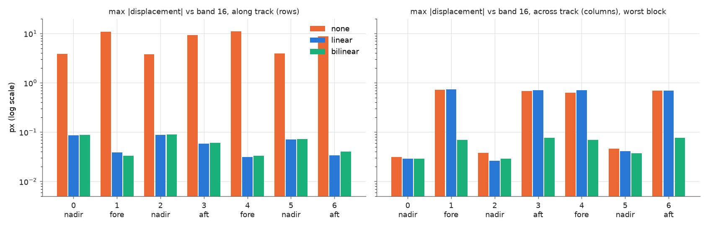

**Measured vs predicted.** Every band, satellite and block lies on the identity line. For rows in mode none, the
measured value is within 0.09 px of the prediction over a range of ±11 px. For columns, it is within 0.06 px over
±0.75 px. So the cubes contain exactly the misregistration their frame indices imply, and the estimator is
unbiased at this level.

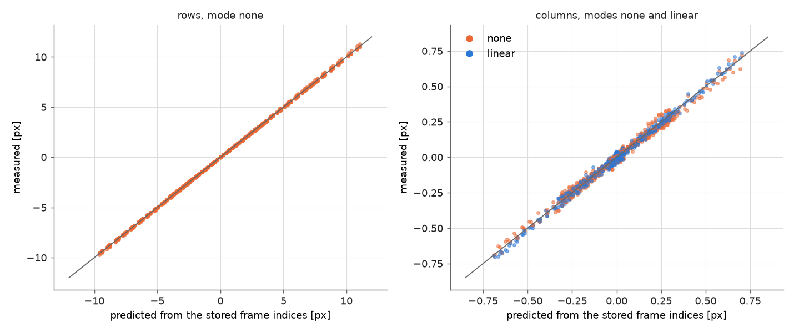

### 6.3 What each mode fixes

**Mode none, along track.** Integer frame stepping assumes one row per frame. The ground actually advances s rows
per frame, so band b shows line g + (1 − s)(r_b − g) instead of g. Relative to band 16, the residual is about
(1 − s)(r_b − r₁₆):

| views | 1 − s | residual at band 0 / 31 (r_b − r₁₆ = −472 / +440 rows) |
|---|---|---|
| nadir | −0.0083 | +3.9 / −3.7 px |
| fore/aft | +0.018 … +0.024 | −11 / +10 px |

The prompt expected "up to about 0.5 px". That holds for a pair of nearby bands, about 60 rows apart, not for 32
bands spread over 912 rows.

**Mode linear, along track.** It removes this completely: the row residual is ≤ 0.09 px on every satellite.

**Mode linear, across track.** On the fore/aft views the column drift remains:
- 0.29–0.32 px at the band extremes on the whole region, and 0.64–0.74 px in the left block;
- on nadir it is ≤ 0.04 px, so linear is enough there.

**Shape of the column drift.** It is not a symmetric keystone with opposite signs at the two edges.
- It is proportional to the distance from the image centre column 2047.5, where all satellites put the common
  target (report 23, B.1). That column falls inside the right block (region ≈ 920–2340), so the drift is
  ≈ 0 on the right and largest on the left.
- The sign is opposite for fore and aft.
- It grows linearly with r_b − r₁₆.

**Mode bilinear** follows the stored c* and removes it: ≤ 0.04 px on the whole region and ≤ 0.08 px in every block.

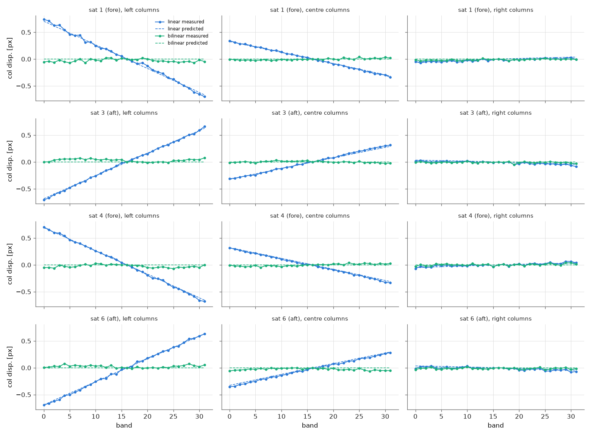

Per-satellite plots, three modes overlaid (dashed = prediction):

| | |
|---|---|
| 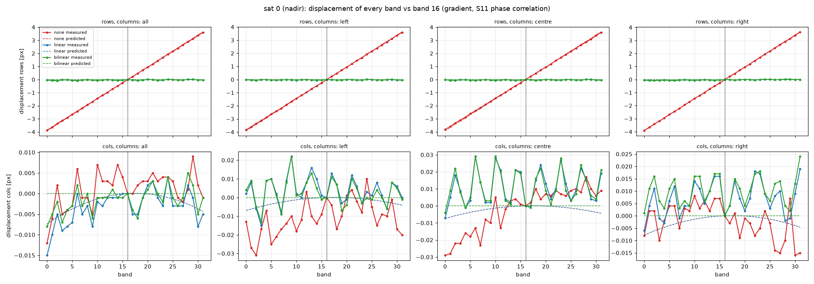 | 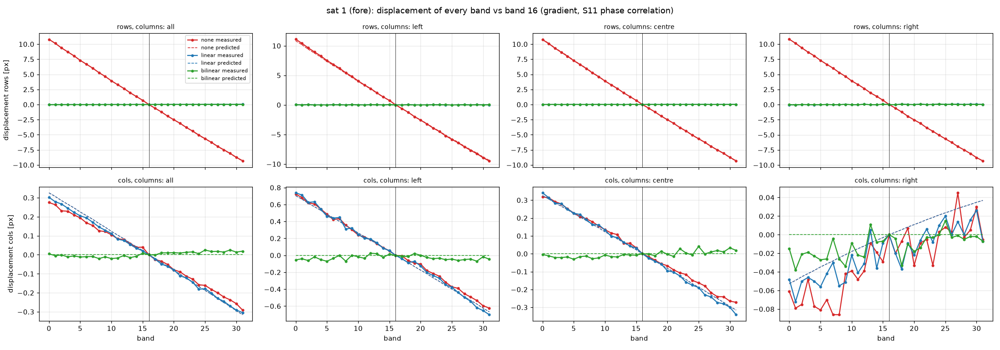 |
| 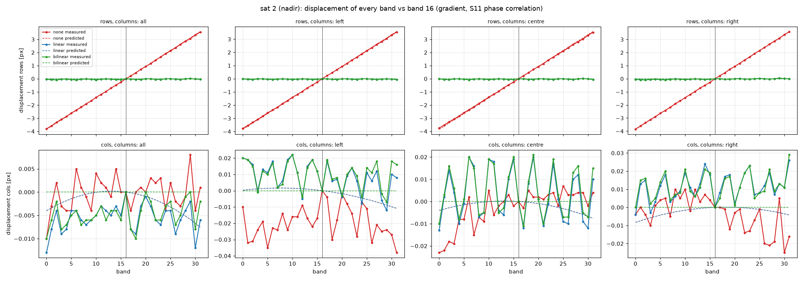 | 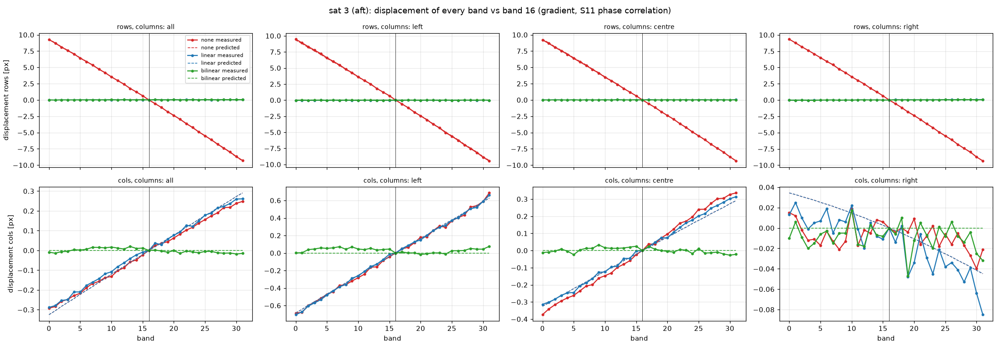 |
| 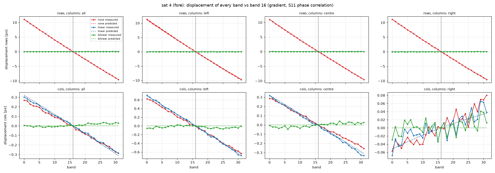 | 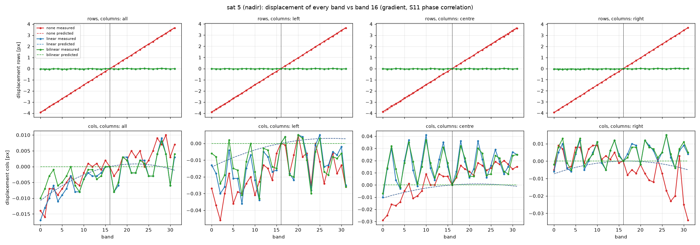 |
| 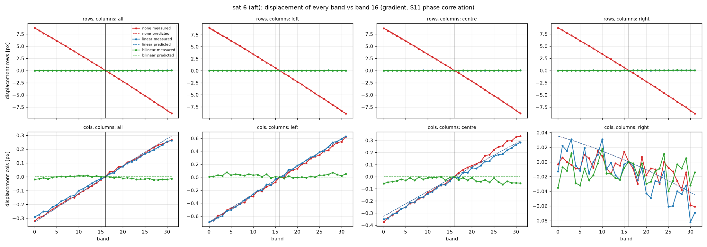 | |

### 6.4 Residuals not explained by the geometry

**1. Nadir linear/bilinear, rows: up to 0.09 px, with a period of about 4.3 bands.**

The residual is the bias of linear interpolation in time. Band b and band 16 are interpolated at fractional frame
phases that differ by φ_b = (r_b − r₁₆)(1/s − 1):
- φ_b steps by about 0.23 frame per band on the nadir views;
- on nadir views the phase is the same for every line and column of a band, so the bias does not average out;
- the residual (after removing a linear trend) correlates with the distance of φ_b from the nearest integer:
  r = −0.97, −0.90, −0.85 for satellites 0, 2, 5;
- the slope is −0.12 to −0.17 px per frame of phase, so about −0.07 px at φ = 0.5.

Where the phase does not vary:
- **fore/aft:** k* varies across lines and columns, so the phase averages out (|r| ≤ 0.25);
- **mode none:** it does not interpolate. Its row residual after a linear fit is 0.004–0.005 px rms on nadir.

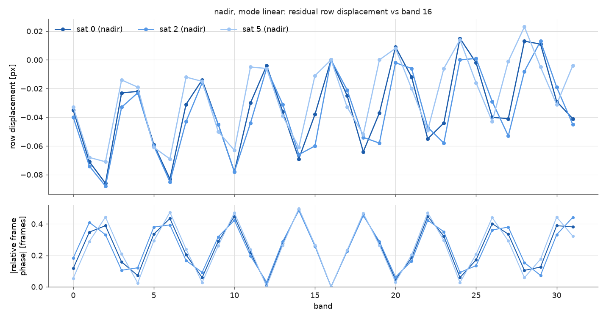

**2. A small linear trend in the row residual (modes linear and bilinear): +0.003 to +0.005 px per 100 rows.**

That is about ±0.02 px at the band extremes, nearly the same for all seven satellites.
In mode none, the measured − predicted row residual has a trend of −0.010 (nadir) and +0.006 to +0.017 px per
100 rows (fore/aft). There the prediction is itself approximate (mean k* over the region). It has the size expected for
height parallax between detector rows 456 rows apart: ≈ 0.0009 px/m × a mean height of ≈ 20 m, compare S10's
+0.045 px on the chief. This explanation was not verified.

**3. Bilinear, fore/aft, left block: column offsets of 0.04–0.08 px.**

Negative for fore (1, 4), positive for aft (3, 6), on most bands and without a clear trend with the band. It may come from the estimator on the
interpolated (smoother) images or from height parallax across track. Not investigated.

None of these residuals calls for a change to the cube code, which was not changed.

## 7. Verdict

| views | mode | why |
|---|---|---|
| nadir (0, 2, 5) | **linear** | removes the 3.8–3.9 px along-track residual of none, down to ≤ 0.09 px (interpolation-phase bias). Bilinear gives the same result (differences 0.05–0.08 DN mean) and costs 1.5× the disk space (70 vs 47 MB) |
| fore / aft (1, 3, 4, 6) | **bilinear** | linear fixes the rows (≤ 0.06 px) but leaves the column drift (0.29–0.32 px globally, up to 0.74 px at the left of the scene); bilinear brings it to ≤ 0.04 px globally and ≤ 0.08 px in every block |
| any | not **none** | 3.8–11 px along track between the band extremes; point "spectra" vary by up to 166 DN |

If a single mode is wanted for the whole swarm, **bilinear** is correct for every view; on nadir it equals linear.

**Open points.**
- The nadir interpolation-phase bias (≤ 0.09 px) could be reduced with a higher-order temporal interpolation, or
  by choosing band rows such that (r_b − r_ref)(1/s − 1) is close to an integer. Not tried.
- The 0.04–0.08 px left-block offset of bilinear on fore/aft is not explained.

## 8. Files, scripts, reproduction

**New in RUN.**

| folder | content | size | in git |
|---|---|---|---|
| `band_samples/` | every band of every satellite, per mode (README inside): `<mode>/band_BB_rowRRRR/satellite_SS.png` (exact cube values, RGBA) + `all_satellites.jpg` (the 7 satellites labelled, viewing only); 96 folders, 672 PNG, 96 JPEG | 210 MB | yes (`.gitignore` exception) |
| `report_25/` | this report, `figures/` (28 PNG), `data/` (registration.csv/.json, points.json) | 20 MB | yes |
| `cubes/inspection/` | all figures of `inspect_cubes.py`: 21 mosaics, 21 composites, 7 mode comparisons, 7 spectra, 7 shift plots, 3 overviews, registration.csv/.json, points.json (69 files) | 55 MB | no |

**Scripts** (CPU only, conda env `orbits`):
- `scripts/inspect_cubes.py`: figures and registration of section 3–6. Parallel over satellites; 5.4 min on
  24 cores.
- `scripts/export_cube_band_samples.py`: `band_samples/`. Parallel over mode × satellite; 12 s.
- `scripts/summarize_cube_inspection.py`: the summary figures of this report, copies the inspection figures,
  prints the Markdown tables.

The range table of section 5 was computed with the functions of `inspect_cubes.py` (`common_region`,
`luminance`) on the points of `points.json`.

**Reproduction:**

    conda activate orbits
    cd scripts
    python inspect_cubes.py --run ../output/orbits_melbourne/20261117T152130Z_run_Vs0yvl --workers 7
    python export_cube_band_samples.py --run ../output/orbits_melbourne/20261117T152130Z_run_Vs0yvl
    python summarize_cube_inspection.py --run ../output/orbits_melbourne/20261117T152130Z_run_Vs0yvl
